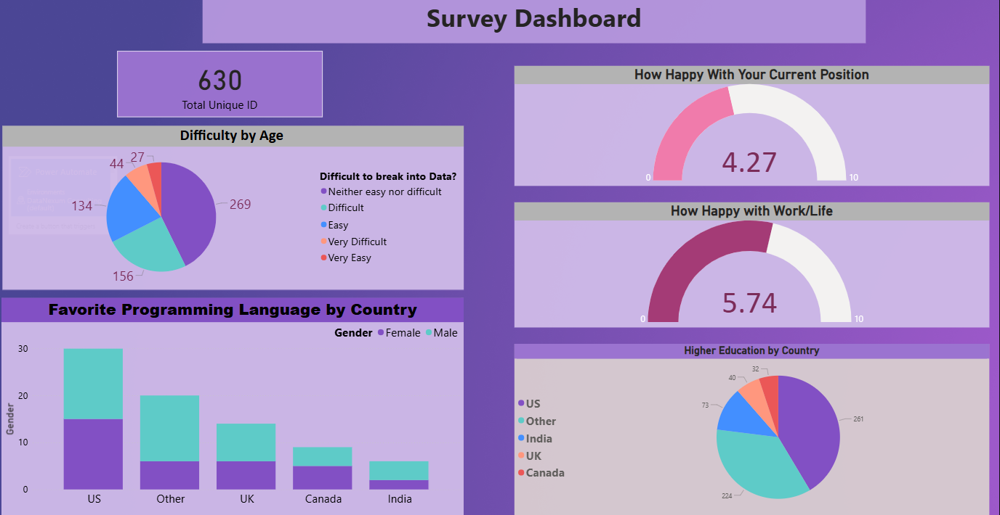

# 📊 Data Analytics Project

This repository contains a Power BI dashboard project built using Excel data.  
It demonstrates skills in **data preparation, visualization, and insight generation**.

---

## 📂 Project Structure
- `data/` → Excel dataset  
- `dashboard/` → Power BI `.pbix` file  
- `screenshots/` → Dashboard preview image  
- `README.md` → Project documentation  

---

## 🔑 Key Insights
- This dashboard provides a clear view of salaries, roles, education, and satisfaction in data careers.
- It connects pay with career growth, management, and learning to show what drives satisfaction.
- It highlights how difficult or easy it is for professionals to break into the data field.
- It shows top job priorities like remote work, better salary, and work-life balance.
- It presents diversity across gender, ethnicity, age, and country in the data workforce.
- It is designed to showcase Power BI skills and deliver insights useful for career decisions.

---

## 🛠 Tools Used
- Microsoft Excel  
- Power BI  

---

## 📸 Dashboard Preview

---

## 🚀 How to Explore
1. Download the `.pbix` file from the `dashboard/` folder  
2. Open it in **Power BI Desktop**  
3. Use filters and slicers to explore the data  
 
 
